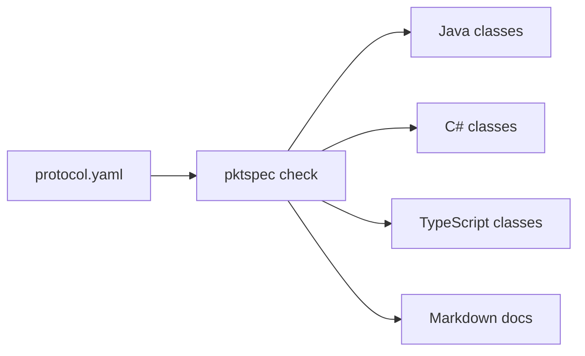

# pktspec

[繁體中文](README.md)

Describe your game packets once in YAML, then generate encoders, decoders and docs for each language.

Game servers and clients often keep their packet layouts only in code. Each side has its own reader and writer, and the two drift apart whenever a field changes. With pktspec the protocol has a single definition, and both the code and the docs are generated from it.



## Quick start

Requires Node.js 20 or later.

```sh
npx pktspec check protocol.yaml
npx pktspec diff old.yaml new.yaml
npx pktspec gen java protocol.yaml -o out/java --package com.example.chat
npx pktspec gen csharp protocol.yaml -o out/csharp --namespace Example.Chat
npx pktspec gen typescript protocol.yaml -o out/ts
npx pktspec gen docs protocol.yaml -o out/docs
```

Example definitions are in [examples/](examples/), such as `examples/chat-room.yaml`.

| Command                                  | What it does                                                   |
| ---------------------------------------- | -------------------------------------------------------------- |
| `pktspec check <file>`                   | Validates a definition and reports errors with line and column |
| `pktspec diff <old> <new>`               | Compares two versions and lists wire compatibility changes     |
| `pktspec gen java <file> -o <dir>`       | Generates Java classes; `--package` sets the package           |
| `pktspec gen csharp <file> -o <dir>`     | Generates C# classes; `--namespace` sets the namespace         |
| `pktspec gen typescript <file> -o <dir>` | Generates TypeScript classes for browsers and Node.js          |
| `pktspec gen docs <file> -o <dir>`       | Generates a Markdown field reference                           |

Errors use the `file:line:column: error: message` format that editors can jump to:

```
protocol.yaml:12:17: error: opcode 0x03 (c2s) is already used by 'Say' at line 8
```

## Definition format

See [`examples/chat-room.yaml`](examples/chat-room.yaml) for a complete example.

```yaml
name: chat-room # used to name the generated classes
version: 1 # optional
endian: little # little or big, default little
opcode: u16 # u8 or u16, default u16

enums:
  RoomKind:
    type: u8
    values:
      PUBLIC: 0
      PRIVATE: 1

structs:
  User:
    fields:
      - { name: id, type: u32 }
      - { name: nickname, type: string, length: u8 }

packets:
  - name: RoomJoined
    opcode: 0x02
    direction: s2c # c2s: client to server; s2c: server to client
    doc: Sent after the client joins a room.
    fields:
      - name: room_id
        type: u32
      - name: kind
        type: RoomKind
      - name: members
        type: User[]
        length: u8 # type of the array's count prefix
```

- Opcodes only need to be unique within one direction; `c2s` and `s2c` may reuse a number.
- Packet, struct and enum names share one namespace and must differ by more than case, because they become file names. Declaration order does not matter. Names must start with an uppercase letter and cannot reuse a built-in type name.
- Field names may be `snake_case` or `camelCase`; the Java and TypeScript generators convert them to `camelCase` and the C# generator to `PascalCase`. Underscores are dropped, so a leading underscore must be followed by a letter (`_1st` is rejected).
- `doc` ends up in the Javadoc, in the C# XML doc comments, in the TypeScript JSDoc and in the generated docs.

### Types

| Type             | Syntax                         | Size (bytes)          | Java type                   | C# type                                 | TypeScript type                                         |
| ---------------- | ------------------------------ | --------------------- | --------------------------- | --------------------------------------- | ------------------------------------------------------- |
| Unsigned integer | `u8` `u16` `u32` `u64`         | 1 / 2 / 4 / 8         | `short` `int` `long` `long` | `byte` `ushort` `uint` `ulong`          | `number` `number` `number` `bigint`                     |
| Signed integer   | `i8` `i16` `i32` `i64`         | 1 / 2 / 4 / 8         | `byte` `short` `int` `long` | `sbyte` `short` `int` `long`            | `number` `number` `number` `bigint`                     |
| Float            | `f32` `f64`                    | 4 / 8                 | `float` `double`            | `float` `double`                        | `number`                                                |
| Boolean          | `bool`                         | 1                     | `boolean`                   | `bool`                                  | `boolean`                                               |
| String           | `string`, `length: u8/u16/u32` | prefix + UTF-8 bytes  | `String`                    | `string`                                | `string`                                                |
| Bytes            | `bytes`, `length: u8/u16/u32`  | prefix + n            | `byte[]`                    | `byte[]`                                | `Uint8Array`                                            |
| Fixed bytes      | `bytes`, `size: 16`            | 16                    | `byte[]`                    | `byte[]`                                | `Uint8Array`                                            |
| Prefixed array   | `T[]`, `length: u8/u16/u32`    | prefix + elements     | `List<T>`                   | `List<T>`                               | `T[]`                                                   |
| Fixed array      | `T[4]`                         | 4 elements            | `List<T>`                   | `List<T>`                               | `T[]`                                                   |
| Struct           | a name from `structs`          | sum of its fields     | generated class             | generated class                         | generated class                                         |
| Enum             | a name from `enums`            | its base integer type | generated `enum`            | generated `enum`, members in PascalCase | `const` object plus a union type, members in PascalCase |

- `length` defaults to `u16`. It counts bytes for strings and bytes, and elements for arrays.
- Java has no unsigned integers, so unsigned types use the next larger type. `u64` uses `long`; values above 2^63 appear negative and can be printed with `Long.toUnsignedString`.
- C# has native unsigned integers, so each type maps directly and integers need no range checks.
- TypeScript uses `bigint` for `u64` and `i64` and `number` for every other numeric type; writing checks the range and rejects fractions.
- Enum base types can be `u8 u16 u32 i8 i16 i32`.
- Structs may recurse through prefixed arrays (trees, for example), but cannot contain themselves directly or through a fixed array.
- Arrays of `bytes` are not supported yet; wrap the bytes in a struct.

## Generated code

The Java output depends only on `java.nio.ByteBuffer` and compiles on Java 8 and later. Each packet gets its own class, plus an entry point that dispatches on the opcode:

```java
Say say = new Say(42, "hello");
byte[] data = say.encode();                    // opcode + body

Packet packet = ChatRoomProtocol.decodeFromClient(data);
if (packet instanceof Say) {
    System.out.println(((Say) packet).text);
}
```

```java
public final class Say implements Packet {
    public static final int OPCODE = 0x0003;

    public long roomId;
    public String text = "";

    @Override
    public void writeTo(ByteBuffer buf) {
        ChatRoomCodec.writeU32(buf, this.roomId);
        ChatRoomCodec.writeString(buf, this.text, 2);
    }

    public static Say readFrom(ByteBuffer buf) {
        Say result = new Say();
        result.roomId = ChatRoomCodec.readU32(buf);
        result.text = ChatRoomCodec.readString(buf, 2);
        return result;
    }
    // plus constructors, bodySize, equals, hashCode and toString
}
```

Writing checks value ranges, string lengths and fixed array sizes, and throws `IllegalArgumentException` instead of silently truncating.

### C#

The C# output is written in C# 9 and compiles against .NET Standard 2.1 (Unity 2021.2 and later, and .NET servers), depending only on types in `System`. Each packet gets its own class, plus an entry point that dispatches on the opcode. The byte order is fixed by the definition:

```csharp
var say = new Say(42, "hello");
byte[] data = say.Encode();                    // opcode + body

IPacket packet = ChatRoomProtocol.DecodeFromClient(data);
if (packet is Say received)
{
    Console.WriteLine(received.Text);
}
```

```csharp
public sealed class Say : IPacket, IEquatable<Say>
{
    public const int OpcodeValue = 0x0003;

    public uint RoomId { get; set; }
    public string Text { get; set; } = "";

    public void WriteTo(PacketWriter writer)
    {
        writer.WriteU32(this.RoomId);
        writer.WriteString(this.Text, 2);
    }

    public static Say ReadFrom(PacketReader reader)
    {
        Say result = new Say();
        result.RoomId = reader.ReadU32();
        result.Text = reader.ReadString(2);
        return result;
    }
    // plus constructors, BodySize, Equals, GetHashCode and ToString
}
```

- Members are always `PascalCase`. A field that clashes with a generated member (`Opcode`, `BodySize`, `WriteTo`), the class name or another type name gets an underscore appended.
- Writing throws `ArgumentException` when a length does not fit its prefix or a fixed array has the wrong number of elements. Reading throws `EndOfStreamException` when the data ends early, and `InvalidDataException` for an unknown opcode or enum value.
- `PacketReader`, `PacketWriter` and `IPacket` are generated alongside, all in the output directory with no subdirectories.

### TypeScript

The TypeScript output has no dependencies. It only uses `DataView`, `Uint8Array`, `TextEncoder` and `TextDecoder`, so it runs in browsers and on Node.js 18 and later. It needs a compile target of ES2020 or later (for `bigint`) and `TextEncoder` types (a `lib` that includes `DOM`, or `@types/node`). Each type gets its own `.ts` file, and every import carries a `.js` extension so Node's ESM and bundlers both work. It avoids `enum`, namespaces and constructor parameter properties, so it also compiles under `erasableSyntaxOnly` and `isolatedModules`:

```ts
import { ChatRoomProtocol, Say } from './out/ts/index.js';

const say = new Say(42, 'hello');
const data = say.encode(); // opcode + body, a Uint8Array

const packet = ChatRoomProtocol.decodeFromClient(data);
if (packet instanceof Say) {
  console.log(packet.text);
}
```

```ts
export class Say implements Packet {
  static readonly OPCODE = 0x0003;

  roomId: number;
  text: string;

  writeTo(writer: PacketWriter): void {
    writer.writeU32(this.roomId);
    writer.writeString(this.text, 2);
  }

  static readFrom(reader: PacketReader): Say {
    const result = new Say();
    result.roomId = reader.readU32();
    result.text = reader.readString(2);
    return result;
  }
  // plus a constructor, bodySize, encode, equals and toString
}
```

- Members are always `camelCase`. A field that clashes with a generated member (`opcode`, `bodySize`, `writeTo`) or an `Object` member gets an underscore appended. A field named like a reserved word (such as `class`) keeps its property name; only the constructor parameter gets the underscore.
- An enum is a `const` object plus a union type of the same name, for example `LoginStatus.BadPassword`, with members in PascalCase.
- Writing throws `RangeError` when a number is out of range or fractional, a length does not fit its prefix, or a fixed array has the wrong number of elements. Reading throws `TruncatedPacketError` when the data ends early, and `InvalidPacketError` for an unknown opcode or enum value or a length above 2^31 - 1.
- There is no `hashCode`, and a `f32` or `f64` NaN is always written as the canonical NaN rather than keeping its original bits.
- Type names cannot reuse names the generated code depends on, such as `Packet`, `Index`, `Uint8Array` or `Error`.

The docs generator produces field tables like this one:

| Field     | Type                       | Size (bytes) | Description |
| --------- | -------------------------- | ------------ | ----------- |
| `room_id` | u32                        | 4            |             |
| `kind`    | [RoomKind](#roomkind)      | 1            |             |
| `members` | [User](#user)[] (u8 count) | 1 + variable |             |

## Comparing versions

`pktspec diff old.yaml new.yaml` compares two definitions and lists the differences grouped by severity. Line numbers come from the new file, with the old file's position in parentheses; `--format json` prints a machine-readable report.

```
$ pktspec diff v1.yaml v2.yaml
breaking (2)
  v2.yaml:15:17: struct 'Vec2' field 'x': type changed from i16 to i32 (used by: Move) (was v1.yaml:14:17)
  v1.yaml:31:11: packet 'Ping' (0x03, c2s) removed

compatible (2)
  v2.yaml:10:7: enum 'Team' value 'GREEN' (2) added
  v2.yaml:32:11: packet 'Chat' (0x04, c2s) added

info (2)
  v2.yaml:1:1: version changed from '1' to '2' (was v1.yaml:1:1)
  v2.yaml:23:17: packet 'Join' field 'id': renamed from 'player_id' (was v1.yaml:22:17)

2 breaking, 2 compatible, 2 info
```

The wire format is an opcode followed by the fields in order, with no names or tags, so the rules look at how the bytes are laid out:

| Severity   | Changes                                                                                                                                                                                                                                                                                                                                                                       |
| ---------- | ----------------------------------------------------------------------------------------------------------------------------------------------------------------------------------------------------------------------------------------------------------------------------------------------------------------------------------------------------------------------------- |
| breaking   | Endianness or opcode width; a packet removed or its opcode or direction changed; a field added or removed (the bytes after it shift); a field's type, size, length prefix, fixed length or array element type; a reorder that changes the layout; an enum's underlying type, a value removed or renumbered; the same changes inside a struct (with the packets that carry it) |
| compatible | A new packet with a new opcode, a new enum value, a new struct or enum                                                                                                                                                                                                                                                                                                        |
| info       | Protocol rename, `version` or `doc` changes; a field, packet or enum value renamed with the same position and type; a type renamed with the same layout; a reorder that leaves the layout unchanged                                                                                                                                                                           |

- A breaking change to a struct or enum that no packet uses is reported as info.
- A new enum value counts as compatible, but the generated code throws on values it does not know, so an older peer that receives the new value still fails.
- Exit codes: 0 when nothing is breaking, 1 when anything is, 2 for usage errors. Like `check`, an unreadable file or one that fails validation exits 1 with the errors on stderr; errors from both files are listed together.

## Roadmap

- [x] Definition parser and `check`
- [x] Java generator
- [x] Markdown docs generator
- [x] C# generator (Unity and .NET servers)
- [x] TypeScript generator (web clients and Node servers)
- [ ] C++ generator
- [ ] Wireshark Lua dissector, so captures show field names
- [x] `pktspec diff old.yaml new.yaml` to list changes and compatibility problems between versions
- [ ] Fuzz test data generated from the definition
- [ ] Conditional fields (a value decides whether later fields are present) and bit fields

## Development

```sh
npm test            # unit tests, golden files, Java, C# and TypeScript round trips (Java and C# need javac and dotnet)
npm run lint        # ESLint + Prettier
npx vitest run -u   # update golden files after an intended generator change
```

The round-trip tests encode and decode every packet with edge-case values and check that nothing changes. The Java one needs `javac` and `java` on the PATH; the C# one needs the .NET SDK 8 or later (`dotnet`). Either is skipped when its tools are missing, unless `PKTSPEC_REQUIRE_JAVA` or `PKTSPEC_REQUIRE_DOTNET` is set, which makes the missing tool a failure. The TypeScript one compiles the generated code with the project's own `tsc` in strict mode (including `noUncheckedIndexedAccess`, `noUnusedLocals` and `erasableSyntaxOnly`) and runs it on Node.js, so it needs no extra tools.

## License

[MIT](LICENSE) © 冷牛
