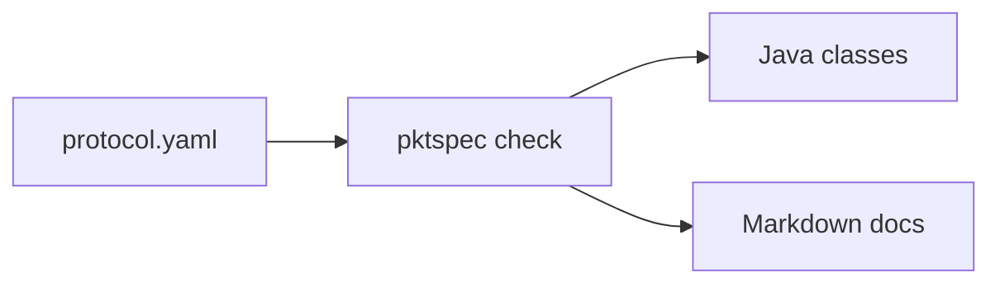

# pktspec

[繁體中文](README.md)

Describe your game packets once in YAML, then generate encoders, decoders and docs for each language.

Game servers and clients often keep their packet layouts only in code. Each side has its own reader and writer, and the two drift apart whenever a field changes. With pktspec the protocol has a single definition, and both the code and the docs are generated from it.



## Quick start

Requires Node.js 20 or later.

```sh
git clone https://github.com/vtxe02023274/pktspec.git
cd pktspec
npm install
npm run build

node dist/bin.js check examples/chat-room.yaml
node dist/bin.js gen java examples/chat-room.yaml -o out/java --package com.example.chat
node dist/bin.js gen docs examples/chat-room.yaml -o out/docs
```

| Command                            | What it does                                                   |
| ---------------------------------- | -------------------------------------------------------------- |
| `pktspec check <file>`             | Validates a definition and reports errors with line and column |
| `pktspec gen java <file> -o <dir>` | Generates Java classes; `--package` sets the package           |
| `pktspec gen docs <file> -o <dir>` | Generates a Markdown field reference                           |

Errors use the `file:line:column: error: message` format that editors can jump to:

```
protocol.yaml:12:17: error: opcode 0x03 (c2s) is already used by 'Say' at line 8
```

## Definition format

See [`examples/chat-room.yaml`](examples/chat-room.yaml) for a complete example.

```yaml
name: chat-room # used to name the generated classes
version: 1 # optional
endian: little # little or big, default little
opcode: u16 # u8 or u16, default u16

enums:
  RoomKind:
    type: u8
    values:
      PUBLIC: 0
      PRIVATE: 1

structs:
  User:
    fields:
      - { name: id, type: u32 }
      - { name: nickname, type: string, length: u8 }

packets:
  - name: RoomJoined
    opcode: 0x02
    direction: s2c # c2s: client to server; s2c: server to client
    doc: Sent after the client joins a room.
    fields:
      - name: room_id
        type: u32
      - name: kind
        type: RoomKind
      - name: members
        type: User[]
        length: u8 # type of the array's count prefix
```

- Opcodes only need to be unique within one direction; `c2s` and `s2c` may reuse a number.
- Packet, struct and enum names share one namespace and must differ by more than case, because they become file names. Declaration order does not matter. Names must start with an uppercase letter and cannot reuse a built-in type name.
- Field names may be `snake_case` or `camelCase`; the Java generator converts them to `camelCase`. Underscores are dropped, so a leading underscore must be followed by a letter (`_1st` is rejected).
- `doc` ends up in the Javadoc and in the generated docs.

### Types

| Type             | Syntax                         | Size (bytes)          | Java type                   |
| ---------------- | ------------------------------ | --------------------- | --------------------------- |
| Unsigned integer | `u8` `u16` `u32` `u64`         | 1 / 2 / 4 / 8         | `short` `int` `long` `long` |
| Signed integer   | `i8` `i16` `i32` `i64`         | 1 / 2 / 4 / 8         | `byte` `short` `int` `long` |
| Float            | `f32` `f64`                    | 4 / 8                 | `float` `double`            |
| Boolean          | `bool`                         | 1                     | `boolean`                   |
| String           | `string`, `length: u8/u16/u32` | prefix + UTF-8 bytes  | `String`                    |
| Bytes            | `bytes`, `length: u8/u16/u32`  | prefix + n            | `byte[]`                    |
| Fixed bytes      | `bytes`, `size: 16`            | 16                    | `byte[]`                    |
| Prefixed array   | `T[]`, `length: u8/u16/u32`    | prefix + elements     | `List<T>`                   |
| Fixed array      | `T[4]`                         | 4 elements            | `List<T>`                   |
| Struct           | a name from `structs`          | sum of its fields     | generated class             |
| Enum             | a name from `enums`            | its base integer type | generated `enum`            |

- `length` defaults to `u16`. It counts bytes for strings and bytes, and elements for arrays.
- Java has no unsigned integers, so unsigned types use the next larger type. `u64` uses `long`; values above 2^63 appear negative and can be printed with `Long.toUnsignedString`.
- Enum base types can be `u8 u16 u32 i8 i16 i32`.
- Structs may recurse through prefixed arrays (trees, for example), but cannot contain themselves directly or through a fixed array.
- Arrays of `bytes` are not supported yet; wrap the bytes in a struct.

## Generated code

The Java output depends only on `java.nio.ByteBuffer` and compiles on Java 8 and later. Each packet gets its own class, plus an entry point that dispatches on the opcode:

```java
Say say = new Say(42, "hello");
byte[] data = say.encode();                    // opcode + body

Packet packet = ChatRoomProtocol.decodeFromClient(data);
if (packet instanceof Say) {
    System.out.println(((Say) packet).text);
}
```

```java
public final class Say implements Packet {
    public static final int OPCODE = 0x0003;

    public long roomId;
    public String text = "";

    @Override
    public void writeTo(ByteBuffer buf) {
        ChatRoomCodec.writeU32(buf, this.roomId);
        ChatRoomCodec.writeString(buf, this.text, 2);
    }

    public static Say readFrom(ByteBuffer buf) {
        Say result = new Say();
        result.roomId = ChatRoomCodec.readU32(buf);
        result.text = ChatRoomCodec.readString(buf, 2);
        return result;
    }
    // plus constructors, bodySize, equals, hashCode and toString
}
```

Writing checks value ranges, string lengths and fixed array sizes, and throws `IllegalArgumentException` instead of silently truncating.

The docs generator produces field tables like this one:

| Field     | Type                       | Size (bytes) | Description |
| --------- | -------------------------- | ------------ | ----------- |
| `room_id` | u32                        | 4            |             |
| `kind`    | [RoomKind](#roomkind)      | 1            |             |
| `members` | [User](#user)[] (u8 count) | 1 + variable |             |

## Roadmap

- [x] Definition parser and `check`
- [x] Java generator
- [x] Markdown docs generator
- [ ] C# generator (Unity and .NET servers)
- [ ] TypeScript generator (web clients and Node servers)
- [ ] C++ generator
- [ ] Wireshark Lua dissector, so captures show field names
- [ ] `pktspec diff old.yaml new.yaml` to list changes and compatibility problems between versions
- [ ] Fuzz test data generated from the definition
- [ ] Conditional fields (a value decides whether later fields are present) and bit fields

## Development

```sh
npm test            # unit tests, golden files, Java round trip (when javac is available)
npm run lint        # ESLint + Prettier
npx vitest run -u   # update golden files after an intended generator change
```

The round-trip test encodes and decodes every packet with edge-case values and checks that nothing changes. It needs `javac` and `java` on the PATH.

## License

[MIT](LICENSE) © 冷牛
