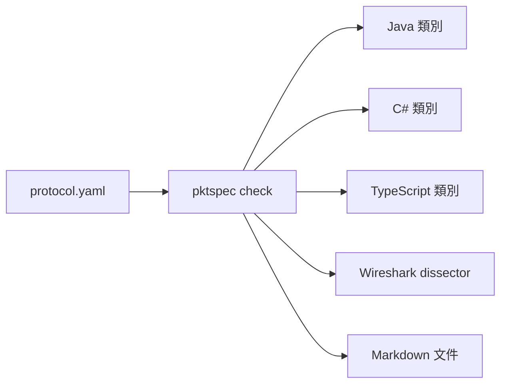

# pktspec

[English](README.en.md)

用一份 YAML 描述遊戲封包的欄位，自動產生各語言的讀寫程式碼與文件。

遊戲伺服器和客戶端的封包格式常常只存在程式碼裡，兩邊各寫一份讀寫程式，欄位一改就對不上。pktspec 讓協定只有一份定義，程式碼和文件都從它產生。



## 快速開始

需要 Node.js 20 以上。

```sh
npx pktspec check protocol.yaml
npx pktspec diff old.yaml new.yaml
npx pktspec gen java protocol.yaml -o out/java --package com.example.chat
npx pktspec gen csharp protocol.yaml -o out/csharp --namespace Example.Chat
npx pktspec gen typescript protocol.yaml -o out/ts
npx pktspec gen wireshark protocol.yaml -o out/wireshark --port 7000
npx pktspec gen docs protocol.yaml -o out/docs
```

範例定義檔在 [examples/](examples/)，例如 `examples/chat-room.yaml`。

| 指令                                     | 作用                                                  |
| ---------------------------------------- | ----------------------------------------------------- |
| `pktspec check <file>`                   | 檢查定義檔，錯誤會標出行號與欄位                      |
| `pktspec diff <old> <new>`               | 比對兩個版本，列出線上格式的相容性差異                |
| `pktspec gen java <file> -o <dir>`       | 產生 Java 類別，`--package` 指定套件名稱              |
| `pktspec gen csharp <file> -o <dir>`     | 產生 C# 類別，`--namespace` 指定命名空間              |
| `pktspec gen typescript <file> -o <dir>` | 產生 TypeScript 類別，瀏覽器與 Node.js 都能用         |
| `pktspec gen wireshark <file> -o <dir>`  | 產生 Wireshark Lua dissector，`--port` 指定預設連接埠 |
| `pktspec gen docs <file> -o <dir>`       | 產生 Markdown 欄位文件                                |

錯誤訊息的格式是 `檔案:行:欄: error: 說明`，編輯器可以直接跳到該處：

```
protocol.yaml:12:17: error: opcode 0x03 (c2s) is already used by 'Say' at line 8
```

## 定義檔格式

完整範例見 [`examples/chat-room.yaml`](examples/chat-room.yaml)。

```yaml
name: chat-room # 協定名稱，用來命名產生的類別
version: 1 # 選填
endian: little # little 或 big，預設 little
opcode: u16 # u8 或 u16，預設 u16

enums:
  RoomKind:
    type: u8
    values:
      PUBLIC: 0
      PRIVATE: 1

structs:
  User:
    fields:
      - { name: id, type: u32 }
      - { name: nickname, type: string, length: u8 }

packets:
  - name: RoomJoined
    opcode: 0x02
    direction: s2c # c2s：客戶端送伺服器；s2c：伺服器送客戶端
    doc: 進房成功後伺服器回傳房間資訊。
    fields:
      - name: room_id
        type: u32
      - name: kind
        type: RoomKind
      - name: members
        type: User[]
        length: u8 # 陣列長度前綴的型別
```

- 封包的 opcode 只要在同一個方向內不重複；`c2s` 和 `s2c` 可以共用同一個號碼。
- 封包、結構、列舉的名稱不能重複（不分大小寫，因為名稱會當成檔名），宣告順序不影響；名稱要以大寫字母開頭，也不能和內建型別同名。
- 欄位名稱用 `snake_case` 或 `camelCase` 都可以，產生 Java 與 TypeScript 時會轉成 `camelCase`，產生 C# 時會轉成 `PascalCase`；底線會被去掉，所以開頭的底線之後必須是字母（`_1st` 不行）。
- `doc` 會寫進產生的 Javadoc、C# XML 文件註解、TypeScript 的 JSDoc 和文件。

### 型別

| 型別             | 寫法                           | 大小（位元組）      | Java 型別                   | C# 型別                            | TypeScript 型別                             |
| ---------------- | ------------------------------ | ------------------- | --------------------------- | ---------------------------------- | ------------------------------------------- |
| 無號整數         | `u8` `u16` `u32` `u64`         | 1 / 2 / 4 / 8       | `short` `int` `long` `long` | `byte` `ushort` `uint` `ulong`     | `number` `number` `number` `bigint`         |
| 有號整數         | `i8` `i16` `i32` `i64`         | 1 / 2 / 4 / 8       | `byte` `short` `int` `long` | `sbyte` `short` `int` `long`       | `number` `number` `number` `bigint`         |
| 浮點數           | `f32` `f64`                    | 4 / 8               | `float` `double`            | `float` `double`                   | `number`                                    |
| 布林             | `bool`                         | 1                   | `boolean`                   | `bool`                             | `boolean`                                   |
| 字串             | `string`，`length: u8/u16/u32` | 前綴 + UTF-8 位元組 | `String`                    | `string`                           | `string`                                    |
| 位元組           | `bytes`，`length: u8/u16/u32`  | 前綴 + n            | `byte[]`                    | `byte[]`                           | `Uint8Array`                                |
| 固定長度位元組   | `bytes`，`size: 16`            | 16                  | `byte[]`                    | `byte[]`                           | `Uint8Array`                                |
| 陣列（長度前綴） | `T[]`，`length: u8/u16/u32`    | 前綴 + 元素         | `List<T>`                   | `List<T>`                          | `T[]`                                       |
| 陣列（固定長度） | `T[4]`                         | 4 個元素            | `List<T>`                   | `List<T>`                          | `T[]`                                       |
| 結構             | `structs` 裡的名稱             | 各欄位相加          | 產生的類別                  | 產生的類別                         | 產生的類別                                  |
| 列舉             | `enums` 裡的名稱               | 底層整數型別        | 產生的 `enum`               | 產生的 `enum`，成員改成 PascalCase | `const` 物件加聯集型別，成員改成 PascalCase |

- `length` 沒寫時預設 `u16`，單位是位元組數（字串、位元組）或元素個數（陣列）。
- Java 沒有無號整數，所以無號型別用大一級的型別存放；`u64` 用 `long`，超過 2^63 的值會以負數表示，可用 `Long.toUnsignedString` 顯示。
- C# 有原生的無號整數，直接用對應型別，所以整數不需要範圍檢查。
- TypeScript 的 `u64`、`i64` 用 `bigint`，其餘數字都用 `number`；寫入時會檢查範圍，也不接受小數。
- 列舉的底層型別可用 `u8 u16 u32 i8 i16 i32`。
- 結構可以透過長度前綴陣列遞迴（例如樹狀結構），但不能直接或透過固定長度陣列包含自己。
- 目前不支援 `bytes` 的陣列，請包成結構。

## 產生的程式碼

Java 只用標準函式庫的 `java.nio.ByteBuffer`，可在 Java 8 以上編譯。每個封包一個類別，另有依 opcode 分派的進入點：

```java
Say say = new Say(42, "hello");
byte[] data = say.encode();                    // opcode + 內容

Packet packet = ChatRoomProtocol.decodeFromClient(data);
if (packet instanceof Say) {
    System.out.println(((Say) packet).text);
}
```

```java
public final class Say implements Packet {
    public static final int OPCODE = 0x0003;

    public long roomId;
    public String text = "";

    @Override
    public void writeTo(ByteBuffer buf) {
        ChatRoomCodec.writeU32(buf, this.roomId);
        ChatRoomCodec.writeString(buf, this.text, 2);
    }

    public static Say readFrom(ByteBuffer buf) {
        Say result = new Say();
        result.roomId = ChatRoomCodec.readU32(buf);
        result.text = ChatRoomCodec.readString(buf, 2);
        return result;
    }
    // 另有建構子、bodySize、equals、hashCode、toString
}
```

寫入時會檢查數值範圍、字串長度和固定長度陣列的元素數，超出就丟 `IllegalArgumentException`，不會默默截斷。

### C#

C# 產生的程式碼用 C# 9 寫成，可編譯到 .NET Standard 2.1（Unity 2021.2 以上與 .NET 伺服器都能用），只依賴 `System` 底下的型別。每個封包一個類別，另有依 opcode 分派的進入點，位元組順序依定義檔固定：

```csharp
var say = new Say(42, "hello");
byte[] data = say.Encode();                    // opcode + 內容

IPacket packet = ChatRoomProtocol.DecodeFromClient(data);
if (packet is Say received)
{
    Console.WriteLine(received.Text);
}
```

```csharp
public sealed class Say : IPacket, IEquatable<Say>
{
    public const int OpcodeValue = 0x0003;

    public uint RoomId { get; set; }
    public string Text { get; set; } = "";

    public void WriteTo(PacketWriter writer)
    {
        writer.WriteU32(this.RoomId);
        writer.WriteString(this.Text, 2);
    }

    public static Say ReadFrom(PacketReader reader)
    {
        Say result = new Say();
        result.RoomId = reader.ReadU32();
        result.Text = reader.ReadString(2);
        return result;
    }
    // 另有建構子、BodySize、Equals、GetHashCode、ToString
}
```

- 成員一律用 `PascalCase`；和產生的成員（`Opcode`、`BodySize`、`WriteTo`）、類別名稱或其他型別名稱衝突的欄位，會在名稱後面加底線。
- 長度前綴放不下、固定長度陣列元素數不對，寫入時丟 `ArgumentException`；資料不足丟 `EndOfStreamException`；opcode 或列舉值未知丟 `InvalidDataException`。
- `PacketReader`、`PacketWriter` 和 `IPacket` 會一起產生，檔案放在輸出目錄，沒有子目錄。

### TypeScript

TypeScript 產生的程式碼不依賴任何套件，只用 `DataView`、`Uint8Array`、`TextEncoder` 和 `TextDecoder`，瀏覽器與 Node.js 18 以上都能跑。需要 ES2020 以上的編譯目標（`bigint`），並且要有 `TextEncoder` 的型別（`lib` 含 `DOM` 或安裝 `@types/node`）。每個型別一個 `.ts` 檔，import 一律帶 `.js` 副檔名，Node 的 ESM 與各種打包工具都能直接用；也不用 `enum`、命名空間和建構子參數屬性，開 `erasableSyntaxOnly` 或 `isolatedModules` 也能編譯：

```ts
import { ChatRoomProtocol, Say } from './out/ts/index.js';

const say = new Say(42, 'hello');
const data = say.encode(); // opcode + 內容，Uint8Array

const packet = ChatRoomProtocol.decodeFromClient(data);
if (packet instanceof Say) {
  console.log(packet.text);
}
```

```ts
export class Say implements Packet {
  static readonly OPCODE = 0x0003;

  roomId: number;
  text: string;

  writeTo(writer: PacketWriter): void {
    writer.writeU32(this.roomId);
    writer.writeString(this.text, 2);
  }

  static readFrom(reader: PacketReader): Say {
    const result = new Say();
    result.roomId = reader.readU32();
    result.text = reader.readString(2);
    return result;
  }
  // 另有建構子、bodySize、encode、equals、toString
}
```

- 成員一律用 `camelCase`；和產生的成員（`opcode`、`bodySize`、`writeTo`）或 `Object` 的成員衝突的欄位，會在名稱後面加底線。欄位名稱是保留字（例如 `class`）時，屬性照用，只有建構子參數會加底線。
- 列舉是 `const` 物件加同名聯集型別，例如 `LoginStatus.BadPassword`，成員改成 PascalCase。
- 數字超出範圍、有小數、長度前綴放不下、固定長度陣列元素數不對，寫入時丟 `RangeError`；資料不足丟 `TruncatedPacketError`；opcode 或列舉值未知、長度超過 2^31 - 1 丟 `InvalidPacketError`。
- 沒有 `hashCode`；`f32`、`f64` 的 NaN 一律寫成標準 NaN，不保留原本的位元內容。
- 型別名稱不能和 `Packet`、`Index`、`Uint8Array`、`Error` 這類產生的程式會用到的名稱衝突。

### Wireshark

`pktspec gen wireshark protocol.yaml -o out/wireshark --port 7000` 產生一個獨立的 `<協定名稱>.lua`，不依賴其他模組，需要 Wireshark 3.6 以上。抓封包時可以直接看到封包名稱、欄位名稱和列舉名稱，也能用 `chat_room.say.text == "hi"` 這類條件過濾。

安裝：把檔案複製到個人外掛資料夾（Wireshark 的「說明 > 關於 Wireshark > 資料夾」裡的 Personal Lua Plugins），重開 Wireshark；也可以不安裝，直接用 `tshark -X lua_script:chat-room.lua -r capture.pcap`。

- 封包在線上只有 opcode 加內容，沒有長度前綴，所以不做 TCP 重組：每個 UDP 封包或 TCP 區段都當成一則訊息，後面多出來的位元組會標成提示。訊息跨區段時會被標成截斷。
- 連接埠：`--port` 是 TCP、UDP、伺服器連接埠三個偏好設定的預設值，沒給就是 0（不註冊）。到「編輯 > 偏好設定 > Protocols > 協定名稱」填 TCP 或 UDP 連接埠，或用「分析 > Decode As」，`tshark` 可用 `-d udp.port==7000,chat_room`。
- 方向：到伺服器連接埠的封包視為 `c2s`，從伺服器連接埠出來的視為 `s2c`；伺服器連接埠沒填時採用 TCP、UDP 連接埠。兩邊都對不上時，opcode 在兩個方向都有定義的話會各試解一次，挑問題較少的，平手就當 `c2s` 並加上提示。
- 欄位名稱是 `協定.封包.欄位`（轉成小寫底線），例如 `chat_room.say.room_id`；結構的欄位用 `協定.結構.欄位`，陣列元素加 `.item`，另有 `協定.packet`、`協定.direction`、`協定.opcode`。
- 專家資訊：資料被截斷、opcode 未知、列舉值未知、長度或元素數超出封包、結構巢狀超過 64 層、封包後有多餘資料、方向無法判斷。

文件產生器輸出的欄位表：

| Field     | Type                       | Size (bytes) | Description |
| --------- | -------------------------- | ------------ | ----------- |
| `room_id` | u32                        | 4            |             |
| `kind`    | [RoomKind](#roomkind)      | 1            |             |
| `members` | [User](#user)[] (u8 count) | 1 + variable |             |

## 比對兩個版本

`pktspec diff old.yaml new.yaml` 比對兩份定義，依嚴重程度分組列出差異。行號以新檔為主，舊檔的位置寫在括號裡；加上 `--format json` 輸出給程式讀。

```
$ pktspec diff v1.yaml v2.yaml
breaking (2)
  v2.yaml:15:17: struct 'Vec2' field 'x': type changed from i16 to i32 (used by: Move) (was v1.yaml:14:17)
  v1.yaml:31:11: packet 'Ping' (0x03, c2s) removed

compatible (2)
  v2.yaml:10:7: enum 'Team' value 'GREEN' (2) added
  v2.yaml:32:11: packet 'Chat' (0x04, c2s) added

info (2)
  v2.yaml:1:1: version changed from '1' to '2' (was v1.yaml:1:1)
  v2.yaml:23:17: packet 'Join' field 'id': renamed from 'player_id' (was v1.yaml:22:17)

2 breaking, 2 compatible, 2 info
```

線上格式只有 opcode 加上依序排列的欄位，沒有欄位名稱或標記，所以規則看的是位元組怎麼排：

| 嚴重程度   | 變更                                                                                                                                                                                                                                                  |
| ---------- | ----------------------------------------------------------------------------------------------------------------------------------------------------------------------------------------------------------------------------------------------------- |
| breaking   | 位元組順序或 opcode 寬度改變；封包移除、opcode 或方向改變；欄位新增、移除（後面的位元組會位移）；欄位型別、大小、長度前綴、固定長度、陣列元素型別改變；欄位順序改變且排列不同；列舉底層型別改變、列舉值移除或改號；結構的上述變更（列出經過哪些封包） |
| compatible | 新封包（新 opcode）、新列舉值、新結構或列舉                                                                                                                                                                                                           |
| info       | 協定改名、`version`、`doc` 變更；欄位、封包、列舉值改名（位置與型別不變）；型別改名但位元組排列相同；欄位順序改變但排列相同                                                                                                                           |

- 沒有任何封包用到的結構或列舉，breaking 變更降為 info。
- 列舉值新增算相容，但產生的程式碼遇到不認識的值會丟錯，舊版對端收到新值仍會失敗。
- 結束碼：沒有 breaking 是 0，有 breaking 是 1，參數錯誤是 2。檔案無法讀取或沒通過 `check` 的檢查時，和 `check` 一樣回 1，錯誤印在 stderr，兩個檔案的錯誤會一起列出。

## 路線圖

- [x] 定義檔解析與 `check`
- [x] Java 產生器
- [x] Markdown 文件產生器
- [x] C# 產生器（Unity 與 .NET 伺服器）
- [x] TypeScript 產生器（網頁客戶端與 Node 伺服器）
- [ ] C++ 產生器
- [x] Wireshark Lua dissector：抓封包時直接看到欄位名稱
- [x] `pktspec diff old.yaml new.yaml`：列出兩個版本的差異與相容性問題
- [ ] 依定義自動產生 fuzz 測試資料
- [ ] 條件欄位（某欄位的值決定後面要不要讀）與位元欄位

## 開發

```sh
npm test            # 單元測試、golden file、Java、C#、TypeScript 往返測試與 Wireshark 測試（Java、C#、Wireshark 要有 javac、dotnet、tshark）
npm run lint        # ESLint + Prettier
npx vitest run -u   # 有意修改產生器輸出時，更新 golden file
```

往返測試會把每個封包用極端值編碼再解碼，確認結果一致。Java 的需要 PATH 裡有 `javac` 和 `java`，C# 的需要 .NET SDK 8 以上（`dotnet`）；找不到就略過，設定環境變數 `PKTSPEC_REQUIRE_JAVA`、`PKTSPEC_REQUIRE_DOTNET` 則會改成直接失敗。TypeScript 的用專案裡的 `tsc` 以嚴格模式（含 `noUncheckedIndexedAccess`、`noUnusedLocals`、`erasableSyntaxOnly`）編譯產生的程式碼，再用 Node.js 執行，不需要額外工具。Wireshark 的測試會在測試裡組出 pcap 檔（Ethernet、IPv4、UDP 或 TCP），用 `tshark -X lua_script:... -T fields` 讀回每個封包的欄位與專家資訊；需要 `tshark`（含 Lua，在 PATH 或 Windows 預設安裝位置），找不到就略過，設定 `PKTSPEC_REQUIRE_TSHARK` 則改為失敗。

## 授權

[MIT](LICENSE) © 冷牛
