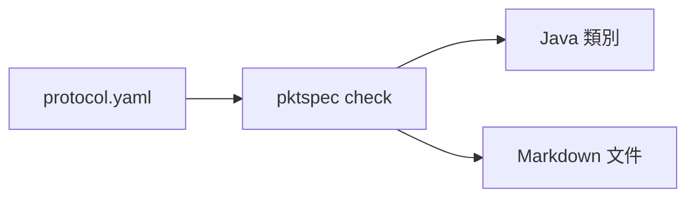

# pktspec

[English](README.en.md)

用一份 YAML 描述遊戲封包的欄位，自動產生各語言的讀寫程式碼與文件。

遊戲伺服器和客戶端的封包格式常常只存在程式碼裡，兩邊各寫一份讀寫程式，欄位一改就對不上。pktspec 讓協定只有一份定義，程式碼和文件都從它產生。



## 快速開始

需要 Node.js 20 以上。

```sh
git clone https://github.com/vtxe02023274/pktspec.git
cd pktspec
npm install
npm run build

node dist/bin.js check examples/chat-room.yaml
node dist/bin.js gen java examples/chat-room.yaml -o out/java --package com.example.chat
node dist/bin.js gen docs examples/chat-room.yaml -o out/docs
```

| 指令                               | 作用                                     |
| ---------------------------------- | ---------------------------------------- |
| `pktspec check <file>`             | 檢查定義檔，錯誤會標出行號與欄位         |
| `pktspec gen java <file> -o <dir>` | 產生 Java 類別，`--package` 指定套件名稱 |
| `pktspec gen docs <file> -o <dir>` | 產生 Markdown 欄位文件                   |

錯誤訊息的格式是 `檔案:行:欄: error: 說明`，編輯器可以直接跳到該處：

```
protocol.yaml:12:17: error: opcode 0x03 (c2s) is already used by 'Say' at line 8
```

## 定義檔格式

完整範例見 [`examples/chat-room.yaml`](examples/chat-room.yaml)。

```yaml
name: chat-room # 協定名稱，用來命名產生的類別
version: 1 # 選填
endian: little # little 或 big，預設 little
opcode: u16 # u8 或 u16，預設 u16

enums:
  RoomKind:
    type: u8
    values:
      PUBLIC: 0
      PRIVATE: 1

structs:
  User:
    fields:
      - { name: id, type: u32 }
      - { name: nickname, type: string, length: u8 }

packets:
  - name: RoomJoined
    opcode: 0x02
    direction: s2c # c2s：客戶端送伺服器；s2c：伺服器送客戶端
    doc: 進房成功後伺服器回傳房間資訊。
    fields:
      - name: room_id
        type: u32
      - name: kind
        type: RoomKind
      - name: members
        type: User[]
        length: u8 # 陣列長度前綴的型別
```

- 封包的 opcode 只要在同一個方向內不重複；`c2s` 和 `s2c` 可以共用同一個號碼。
- 封包、結構、列舉的名稱不能重複，宣告順序不影響。
- 欄位名稱用 `snake_case` 或 `camelCase` 都可以，產生 Java 時會轉成 `camelCase`；底線會被去掉，所以開頭的底線之後必須是字母（`_1st` 不行）。
- `doc` 會寫進產生的 Javadoc 和文件。

### 型別

| 型別             | 寫法                           | 大小（位元組）      | Java 型別                   |
| ---------------- | ------------------------------ | ------------------- | --------------------------- |
| 無號整數         | `u8` `u16` `u32` `u64`         | 1 / 2 / 4 / 8       | `short` `int` `long` `long` |
| 有號整數         | `i8` `i16` `i32` `i64`         | 1 / 2 / 4 / 8       | `byte` `short` `int` `long` |
| 浮點數           | `f32` `f64`                    | 4 / 8               | `float` `double`            |
| 布林             | `bool`                         | 1                   | `boolean`                   |
| 字串             | `string`，`length: u8/u16/u32` | 前綴 + UTF-8 位元組 | `String`                    |
| 位元組           | `bytes`，`length: u8/u16/u32`  | 前綴 + n            | `byte[]`                    |
| 固定長度位元組   | `bytes`，`size: 16`            | 16                  | `byte[]`                    |
| 陣列（長度前綴） | `T[]`，`length: u8/u16/u32`    | 前綴 + 元素         | `List<T>`                   |
| 陣列（固定長度） | `T[4]`                         | 4 個元素            | `List<T>`                   |
| 結構             | `structs` 裡的名稱             | 各欄位相加          | 產生的類別                  |
| 列舉             | `enums` 裡的名稱               | 底層整數型別        | 產生的 `enum`               |

- `length` 沒寫時預設 `u16`，單位是位元組數（字串、位元組）或元素個數（陣列）。
- Java 沒有無號整數，所以無號型別用大一級的型別存放；`u64` 用 `long`，超過 2^63 的值會以負數表示，可用 `Long.toUnsignedString` 顯示。
- 列舉的底層型別可用 `u8 u16 u32 i8 i16 i32`。
- 結構可以透過長度前綴陣列遞迴（例如樹狀結構），但不能直接或透過固定長度陣列包含自己。
- 目前不支援 `bytes` 的陣列，請包成結構。

## 產生的程式碼

Java 只用標準函式庫的 `java.nio.ByteBuffer`，可在 Java 8 以上編譯。每個封包一個類別，另有依 opcode 分派的進入點：

```java
Say say = new Say(42, "hello");
byte[] data = say.encode();                    // opcode + 內容

Packet packet = ChatRoomProtocol.decodeFromClient(data);
if (packet instanceof Say) {
    System.out.println(((Say) packet).text);
}
```

```java
public final class Say implements Packet {
    public static final int OPCODE = 0x0003;

    public long roomId;
    public String text = "";

    @Override
    public void writeTo(ByteBuffer buf) {
        ChatRoomCodec.writeU32(buf, this.roomId);
        ChatRoomCodec.writeString(buf, this.text, 2);
    }

    public static Say readFrom(ByteBuffer buf) {
        Say result = new Say();
        result.roomId = ChatRoomCodec.readU32(buf);
        result.text = ChatRoomCodec.readString(buf, 2);
        return result;
    }
    // 另有建構子、bodySize、equals、hashCode、toString
}
```

寫入時會檢查數值範圍、字串長度和固定長度陣列的元素數，超出就丟 `IllegalArgumentException`，不會默默截斷。

文件產生器輸出的欄位表：

| Field     | Type                       | Size (bytes) | Description |
| --------- | -------------------------- | ------------ | ----------- |
| `room_id` | u32                        | 4            |             |
| `kind`    | [RoomKind](#roomkind)      | 1            |             |
| `members` | [User](#user)[] (u8 count) | 1 + variable |             |

## 路線圖

- [x] 定義檔解析與 `check`
- [x] Java 產生器
- [x] Markdown 文件產生器
- [ ] C# 產生器（Unity 與 .NET 伺服器）
- [ ] TypeScript 產生器（網頁客戶端與 Node 伺服器）
- [ ] C++ 產生器
- [ ] Wireshark Lua dissector：抓封包時直接看到欄位名稱
- [ ] `pktspec diff old.yaml new.yaml`：列出兩個版本的差異與相容性問題
- [ ] 依定義自動產生 fuzz 測試資料
- [ ] 條件欄位（某欄位的值決定後面要不要讀）與位元欄位

## 開發

```sh
npm test            # 單元測試、golden file、Java 往返測試（有 javac 時）
npm run lint        # ESLint + Prettier
npx vitest run -u   # 有意修改產生器輸出時，更新 golden file
```

往返測試會把每個封包用極端值編碼再解碼，確認結果一致，需要 PATH 裡有 `javac` 和 `java`。

## 授權

[MIT](LICENSE) © 冷牛
