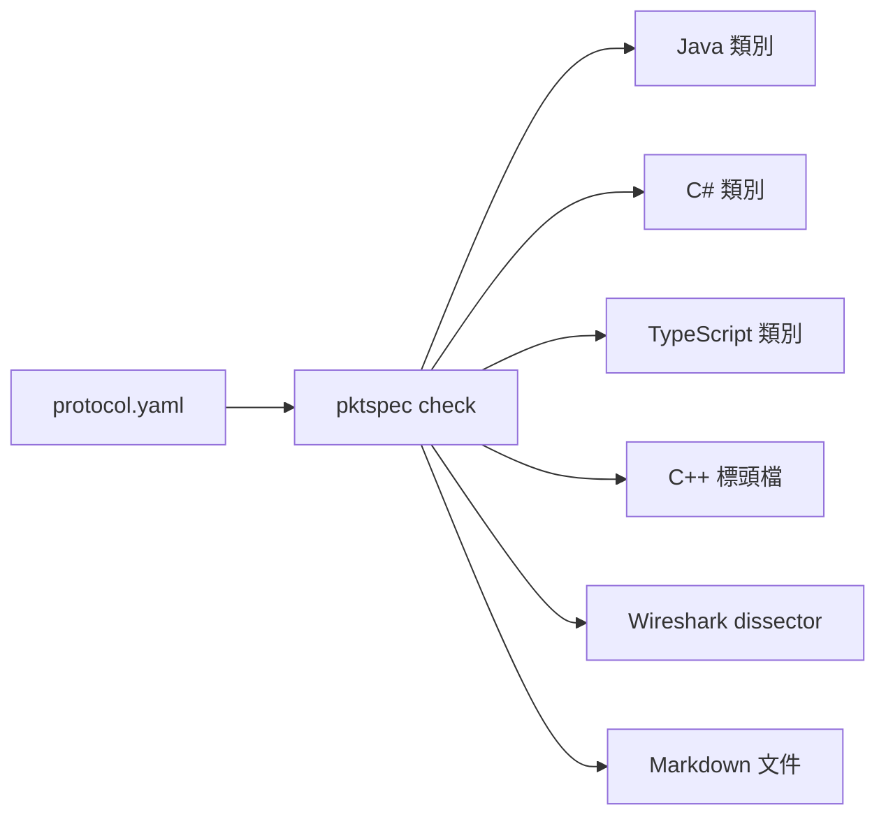

# pktspec

[English](README.en.md)

用一份 YAML 描述遊戲封包的欄位，自動產生各語言的讀寫程式碼與文件。

遊戲伺服器和客戶端的封包格式常常只存在程式碼裡，兩邊各寫一份讀寫程式，欄位一改就對不上。pktspec 讓協定只有一份定義，程式碼和文件都從它產生。



## 快速開始

需要 Node.js 20 以上。

```sh
npx pktspec check protocol.yaml
npx pktspec diff old.yaml new.yaml
npx pktspec gen java protocol.yaml -o out/java --package com.example.chat
npx pktspec gen csharp protocol.yaml -o out/csharp --namespace Example.Chat
npx pktspec gen typescript protocol.yaml -o out/ts
npx pktspec gen cpp protocol.yaml -o out/cpp --namespace Example::Chat
npx pktspec gen wireshark protocol.yaml -o out/wireshark --port 7000
npx pktspec gen docs protocol.yaml -o out/docs
npx pktspec fuzz protocol.yaml -o out/fuzz --seed 1 --count 16
```

範例定義檔在 [examples/](examples/)，例如 `examples/chat-room.yaml`。

| 指令                                     | 作用                                                          |
| ---------------------------------------- | ------------------------------------------------------------- |
| `pktspec check <file>`                   | 檢查定義檔，錯誤會標出行號與欄位                              |
| `pktspec diff <old> <new>`               | 比對兩個版本，列出線上格式的相容性差異                        |
| `pktspec gen java <file> -o <dir>`       | 產生 Java 類別，`--package` 指定套件名稱                      |
| `pktspec gen csharp <file> -o <dir>`     | 產生 C# 類別，`--namespace` 指定命名空間                      |
| `pktspec gen typescript <file> -o <dir>` | 產生 TypeScript 類別，瀏覽器與 Node.js 都能用                 |
| `pktspec gen cpp <file> -o <dir>`        | 產生 C++17 標頭檔，只用標準函式庫，`--namespace` 指定命名空間 |
| `pktspec gen wireshark <file> -o <dir>`  | 產生 Wireshark Lua dissector，`--port` 指定預設連接埠         |
| `pktspec gen docs <file> -o <dir>`       | 產生 Markdown 欄位文件                                        |
| `pktspec fuzz <file> -o <dir>`           | 產生 fuzz 測試資料（有效與無效封包樣本加 manifest）           |

錯誤訊息的格式是 `檔案:行:欄: error: 說明`，編輯器可以直接跳到該處：

```
protocol.yaml:12:17: error: opcode 0x03 (c2s) is already used by 'Say' at line 8
```

## 定義檔格式

完整範例見 [`examples/chat-room.yaml`](examples/chat-room.yaml)。

```yaml
name: chat-room # 協定名稱，用來命名產生的類別
version: 1 # 選填
endian: little # little 或 big，預設 little
opcode: u16 # u8 或 u16，預設 u16

enums:
  RoomKind:
    type: u8
    values:
      PUBLIC: 0
      PRIVATE: 1

structs:
  User:
    fields:
      - { name: id, type: u32 }
      - { name: nickname, type: string, length: u8 }

packets:
  - name: RoomJoined
    opcode: 0x02
    direction: s2c # c2s：客戶端送伺服器；s2c：伺服器送客戶端
    doc: 進房成功後伺服器回傳房間資訊。
    fields:
      - name: room_id
        type: u32
      - name: kind
        type: RoomKind
      - name: members
        type: User[]
        length: u8 # 陣列長度前綴的型別
```

- 封包的 opcode 只要在同一個方向內不重複；`c2s` 和 `s2c` 可以共用同一個號碼。
- 封包、結構、列舉的名稱不能重複（不分大小寫，因為名稱會當成檔名），宣告順序不影響；名稱要以大寫字母開頭，也不能和內建型別同名。
- 欄位名稱用 `snake_case` 或 `camelCase` 都可以，產生 Java、TypeScript 與 C++ 時會轉成 `camelCase`，產生 C# 時會轉成 `PascalCase`；底線會被去掉，所以開頭的底線之後必須是字母（`_1st` 不行）。
- `doc` 會寫進產生的 Javadoc、C# XML 文件註解、TypeScript 的 JSDoc、C++ 的區塊註解和文件。

### 型別

| 型別             | 寫法                           | 大小（位元組）      | Java 型別                   | C# 型別                            | TypeScript 型別                             | C++ 型別                                                       |
| ---------------- | ------------------------------ | ------------------- | --------------------------- | ---------------------------------- | ------------------------------------------- | -------------------------------------------------------------- |
| 無號整數         | `u8` `u16` `u32` `u64`         | 1 / 2 / 4 / 8       | `short` `int` `long` `long` | `byte` `ushort` `uint` `ulong`     | `number` `number` `number` `bigint`         | `std::uint8_t` `std::uint16_t` `std::uint32_t` `std::uint64_t` |
| 有號整數         | `i8` `i16` `i32` `i64`         | 1 / 2 / 4 / 8       | `byte` `short` `int` `long` | `sbyte` `short` `int` `long`       | `number` `number` `number` `bigint`         | `std::int8_t` `std::int16_t` `std::int32_t` `std::int64_t`     |
| 浮點數           | `f32` `f64`                    | 4 / 8               | `float` `double`            | `float` `double`                   | `number`                                    | `float` `double`                                               |
| 布林             | `bool`                         | 1                   | `boolean`                   | `bool`                             | `boolean`                                   | `bool`                                                         |
| 字串             | `string`，`length: u8/u16/u32` | 前綴 + UTF-8 位元組 | `String`                    | `string`                           | `string`                                    | `std::string`                                                  |
| 位元組           | `bytes`，`length: u8/u16/u32`  | 前綴 + n            | `byte[]`                    | `byte[]`                           | `Uint8Array`                                | `std::vector<std::uint8_t>`                                    |
| 固定長度位元組   | `bytes`，`size: 16`            | 16                  | `byte[]`                    | `byte[]`                           | `Uint8Array`                                | `std::array<std::uint8_t, N>`                                  |
| 陣列（長度前綴） | `T[]`，`length: u8/u16/u32`    | 前綴 + 元素         | `List<T>`                   | `List<T>`                          | `T[]`                                       | `std::vector<T>`                                               |
| 陣列（固定長度） | `T[4]`                         | 4 個元素            | `List<T>`                   | `List<T>`                          | `T[]`                                       | `std::array<T, N>`                                             |
| 結構             | `structs` 裡的名稱             | 各欄位相加          | 產生的類別                  | 產生的類別                         | 產生的類別                                  | 產生的 `struct`                                                |
| 列舉             | `enums` 裡的名稱               | 底層整數型別        | 產生的 `enum`               | 產生的 `enum`，成員改成 PascalCase | `const` 物件加聯集型別，成員改成 PascalCase | 產生的 `enum class`，成員改成 PascalCase                       |
| 位元欄位         | `u8` `u16` `u32` 加 `bits`     | 1 / 2 / 4           | 每個子欄位一個成員          | 每個子欄位一個成員                 | 每個子欄位一個成員                          | 每個子欄位一個成員                                             |
| 條件欄位         | 任一型別加 `if`                | 條件不成立時為 0    | 包裝型別（可為 null）       | `T?`                               | `T \| undefined`                            | `std::optional<T>`                                             |

- `length` 沒寫時預設 `u16`，單位是位元組數（字串、位元組）或元素個數（陣列）。
- Java 沒有無號整數，所以無號型別用大一級的型別存放；`u64` 用 `long`，超過 2^63 的值會以負數表示，可用 `Long.toUnsignedString` 顯示。
- C# 有原生的無號整數，直接用對應型別，所以整數不需要範圍檢查。
- C++ 用 `<cstdint>` 的固定寬度整數，所以整數不需要範圍檢查；字串是 `std::string`，位元組原樣複製，不檢查是不是合法的 UTF-8。
- TypeScript 的 `u64`、`i64` 用 `bigint`，其餘數字都用 `number`；寫入時會檢查範圍，也不接受小數。
- 列舉的底層型別可用 `u8 u16 u32 i8 i16 i32`。
- 結構可以透過長度前綴陣列遞迴（例如樹狀結構），但不能直接或透過固定長度陣列包含自己。
- 目前不支援 `bytes` 的陣列，請包成結構。

### 位元欄位

一個 `u8`、`u16` 或 `u32` 整數可以拆成幾個子欄位，在 `bits` 依序列出：

```yaml
fields:
  - name: state
    type: u16 # 底層整數，依 endian 讀寫
    bits:
      - { name: alive, type: bool } # 第 0 位元
      - { name: team, type: Team, bits: 2 } # 第 1–2 位元，列舉
      - { name: level, bits: 7 } # 第 3–9 位元，無號整數
```

- 從最低位元開始排，第一個子欄位在第 0 位元。位元數總和不能超過底層整數的寬度；剩下的高位元寫入時填 0，讀取時忽略。
- 子欄位的 `type` 可以是 `bool`（1 位元，`bits` 可以省略）或列舉（每個值都要是 0 到 2^`bits` - 1，所以不能有負數）；沒寫 `type` 就是無號整數，`bits` 必填。`bits` 至少是 1。
- 在產生的程式碼裡，子欄位就像一般欄位，名稱照各語言的規則轉換；`state` 這個名稱只出現在文件、Wireshark 與 `diff`。子欄位和同一層的欄位共用命名空間，不能重名。無號整數子欄位的型別是放得下它的最小無號型別，例如 7 位元在 Java 是 `short`、在 C# 是 `byte`、在 C++ 是 `std::uint8_t`。
- 寫入時值超出位元數會丟範圍錯誤：Java `IllegalArgumentException`、C# `ArgumentException`、TypeScript `RangeError`、C++ `PacketRangeError`。讀到列舉沒有定義的值時，和一般列舉欄位丟一樣的錯誤。
- 位元欄位不能當陣列元素；要重複就包成結構，再用結構的陣列。

### 條件欄位

欄位加上 `if`，就只在同一個結構或封包裡、排在它前面的某個欄位符合條件時才出現在線上：

```yaml
fields:
  - { name: shape, type: Shape }
  - { name: radius, type: f32, if: { field: shape, equals: CIRCLE } } # shape 是 CIRCLE 才有
  - { name: corner, type: Point, if: { field: shape, in: [RECT, POLYGON] } } # 其中一個值就有
  - { name: has_guild, type: bool }
  - { name: guild, type: Guild, if: has_guild } # bool 為 true 才有
```

- 條件只能測前面的欄位。`bool` 欄位（含位元欄位裡的 `bool`）寫 `if: 欄位名稱`，表示為 true；整數與列舉欄位（含位元欄位裡的無號整數與列舉）用 `equals` 比一個值，或用 `in` 比一組值。列舉寫成員名稱；整數要在型別範圍內，位元欄位在它的位元數內，`u64`、`i64` 限 ±(2^53 - 1)。
- 條件不成立時，這個欄位在線上完全不存在，不佔任何位元組。位元欄位群組也能加條件，整組一起出現或消失。
- 被測的欄位本身也可以是條件欄位：它不存在時，測它的條件一律不成立，所以可以一層層串下去。
- `check` 會擋下測自己、測後面的欄位、測位元欄位群組名稱，或測字串、浮點數、結構、陣列的條件；列舉成員不存在、整數超出範圍、`in` 裡重複的值也會報錯。陣列元素不能各自帶條件。
- 在產生的程式碼裡，條件欄位是可選值：Java 是可為 null 的包裝型別（`Float`、`Long`，參考型別照舊），C# 是 nullable（`float?`、`string?`），TypeScript 是 `T | undefined`，C++ 是 `std::optional<T>`，預設都是空的。解碼時條件不成立就保持空值。
- Java 不用 `Optional`：它不適合當欄位（官方不建議、也不能序列化），而產生的類別是公開欄位，用包裝型別讀寫方式和其他欄位一樣。
- 編碼時條件成立卻沒有值，或條件不成立卻有值，丟各語言寫入時的錯誤：Java `IllegalArgumentException`、C# `ArgumentException`、TypeScript `RangeError`、C++ `PacketRangeError`。`bodySize` 依欄位有沒有值計算。

## 產生的程式碼

Java 只用標準函式庫的 `java.nio.ByteBuffer`，可在 Java 8 以上編譯。每個封包一個類別，另有依 opcode 分派的進入點：

```java
Say say = new Say(42, "hello");
byte[] data = say.encode();                    // opcode + 內容

Packet packet = ChatRoomProtocol.decodeFromClient(data);
if (packet instanceof Say) {
    System.out.println(((Say) packet).text);
}
```

```java
public final class Say implements Packet {
    public static final int OPCODE = 0x0003;

    public long roomId;
    public String text = "";

    @Override
    public void writeTo(ByteBuffer buf) {
        ChatRoomCodec.writeU32(buf, this.roomId);
        ChatRoomCodec.writeString(buf, this.text, 2);
    }

    public static Say readFrom(ByteBuffer buf) {
        Say result = new Say();
        result.roomId = ChatRoomCodec.readU32(buf);
        result.text = ChatRoomCodec.readString(buf, 2);
        return result;
    }
    // 另有建構子、bodySize、equals、hashCode、toString
}
```

寫入時會檢查數值範圍、字串長度和固定長度陣列的元素數，超出就丟 `IllegalArgumentException`，不會默默截斷。

### C#

C# 產生的程式碼用 C# 9 寫成，可編譯到 .NET Standard 2.1（Unity 2021.2 以上與 .NET 伺服器都能用），只依賴 `System` 底下的型別。每個封包一個類別，另有依 opcode 分派的進入點，位元組順序依定義檔固定：

```csharp
var say = new Say(42, "hello");
byte[] data = say.Encode();                    // opcode + 內容

IPacket packet = ChatRoomProtocol.DecodeFromClient(data);
if (packet is Say received)
{
    Console.WriteLine(received.Text);
}
```

```csharp
public sealed class Say : IPacket, IEquatable<Say>
{
    public const int OpcodeValue = 0x0003;

    public uint RoomId { get; set; }
    public string Text { get; set; } = "";

    public void WriteTo(PacketWriter writer)
    {
        writer.WriteU32(this.RoomId);
        writer.WriteString(this.Text, 2);
    }

    public static Say ReadFrom(PacketReader reader)
    {
        Say result = new Say();
        result.RoomId = reader.ReadU32();
        result.Text = reader.ReadString(2);
        return result;
    }
    // 另有建構子、BodySize、Equals、GetHashCode、ToString
}
```

- 成員一律用 `PascalCase`；和產生的成員（`Opcode`、`BodySize`、`WriteTo`）、類別名稱或其他型別名稱衝突的欄位，會在名稱後面加底線。
- 長度前綴放不下、固定長度陣列元素數不對，寫入時丟 `ArgumentException`；資料不足丟 `EndOfStreamException`；opcode 或列舉值未知丟 `InvalidDataException`。
- `PacketReader`、`PacketWriter` 和 `IPacket` 會一起產生，檔案放在輸出目錄，沒有子目錄。

### TypeScript

TypeScript 產生的程式碼不依賴任何套件，只用 `DataView`、`Uint8Array`、`TextEncoder` 和 `TextDecoder`，瀏覽器與 Node.js 18 以上都能跑。需要 ES2020 以上的編譯目標（`bigint`），並且要有 `TextEncoder` 的型別（`lib` 含 `DOM` 或安裝 `@types/node`）。每個型別一個 `.ts` 檔，import 一律帶 `.js` 副檔名，Node 的 ESM 與各種打包工具都能直接用；也不用 `enum`、命名空間和建構子參數屬性，開 `erasableSyntaxOnly` 或 `isolatedModules` 也能編譯：

```ts
import { ChatRoomProtocol, Say } from './out/ts/index.js';

const say = new Say(42, 'hello');
const data = say.encode(); // opcode + 內容，Uint8Array

const packet = ChatRoomProtocol.decodeFromClient(data);
if (packet instanceof Say) {
  console.log(packet.text);
}
```

```ts
export class Say implements Packet {
  static readonly OPCODE = 0x0003;

  roomId: number;
  text: string;

  writeTo(writer: PacketWriter): void {
    writer.writeU32(this.roomId);
    writer.writeString(this.text, 2);
  }

  static readFrom(reader: PacketReader): Say {
    const result = new Say();
    result.roomId = reader.readU32();
    result.text = reader.readString(2);
    return result;
  }
  // 另有建構子、bodySize、encode、equals、toString
}
```

- 成員一律用 `camelCase`；和產生的成員（`opcode`、`bodySize`、`writeTo`）或 `Object` 的成員衝突的欄位，會在名稱後面加底線。欄位名稱是保留字（例如 `class`）時，屬性照用，只有建構子參數會加底線。
- 列舉是 `const` 物件加同名聯集型別，例如 `LoginStatus.BadPassword`，成員改成 PascalCase。
- 數字超出範圍、有小數、長度前綴放不下、固定長度陣列元素數不對，寫入時丟 `RangeError`；資料不足丟 `TruncatedPacketError`；opcode 或列舉值未知、長度超過 2^31 - 1 丟 `InvalidPacketError`。
- 沒有 `hashCode`；`f32`、`f64` 的 NaN 一律寫成標準 NaN，不保留原本的位元內容。
- 型別名稱不能和 `Packet`、`Index`、`Uint8Array`、`Error` 這類產生的程式會用到的名稱衝突。

### C++

C++ 產生的程式碼是 C++17 的標頭檔，只用標準函式庫，沒有 `.cpp`：把輸出目錄加進 include 路徑就能用，伺服器或 Unreal、Unity 的原生外掛都不用另外設定連結。位元組順序依定義檔固定，逐位元組組合，不靠主機的位元組順序；浮點數用 `memcpy` 轉換。命名空間預設由協定名稱轉成 PascalCase，`--namespace Example::Chat`（也接受 `Example.Chat`）可以指定。錯誤用例外回報，所以編譯時要開例外（Unreal 預設是關的）。

```cpp
#include "ChatRoomProtocol.hpp"

using namespace ChatRoom;

Say say(42, "hello");
std::vector<std::uint8_t> data = say.encode();  // opcode + 內容

std::unique_ptr<Packet> packet = ChatRoomProtocol::decodeFromClient(data);
if (packet->opcode() == Say::OpcodeValue) {
    const Say& received = static_cast<const Say&>(*packet);
    std::cout << received.text << "\n";
}
```

```cpp
struct Say final : public Packet {
    static constexpr std::uint16_t OpcodeValue = 0x0003;

    std::uint32_t roomId{};
    std::string text{};

    std::size_t bodySize() const override;
    void writeTo(PacketWriter& writer) const override;
    static Say readFrom(PacketReader& reader);
    // 另有建構子、opcode、operator==、operator!=
};
```

- 解碼回傳 `std::unique_ptr<Packet>`，依 `opcode()` 判斷後轉型。不用 `std::variant`，因為某個方向可能一個封包也沒有（空的 `variant` 不合法），而且伺服器常把封包排進佇列再分派，基底類別指標比較好傳；代價是每個封包一次堆積配置。`decodeFromClient(data, size)` 這種直接吃指標與長度的版本也有。
- 錯誤都繼承 `std::runtime_error`：`TruncatedPacketError` 是資料不足；`InvalidPacketError` 是無效的資料（長度超過 2^31 - 1），它的子類別 `UnknownOpcodeError`（`opcode()` 取得讀到的值）和 `UnknownEnumValueError` 是 opcode 或列舉值未知；`PacketRangeError` 是寫入時長度前綴放不下。以上共同的基底是 `PacketError`。固定長度陣列與位元組是 `std::array`，大小由型別保證，所以沒有「元素數不對」的錯誤。
- 成員一律用 `camelCase`；和產生的成員（`opcode`、`bodySize`、`writeTo`）、C++ 保留字、`min`、`max` 這類常被巨集定義的名稱衝突的欄位，會在名稱後面加底線。
- 結構全部放在 `Structs.hpp`：兩個結構可以用陣列互相包含，每個型別一個標頭就排不出能編譯的順序。封包、列舉各一個標頭，`<協定名稱>Protocol.hpp` 是進入點。
- 沒有 `hashCode`、`toString`；比較浮點數時 NaN 視為相等。
- 型別名稱不能和 `Packet`、`PacketReader`、`Structs`、`NULL` 這類產生的程式會用到的名稱衝突。

### Wireshark

`pktspec gen wireshark protocol.yaml -o out/wireshark --port 7000` 產生一個獨立的 `<協定名稱>.lua`，不依賴其他模組，需要 Wireshark 3.6 以上。抓封包時可以直接看到封包名稱、欄位名稱和列舉名稱，也能用 `chat_room.say.text == "hi"` 這類條件過濾。

安裝：把檔案複製到個人外掛資料夾（Wireshark 的「說明 > 關於 Wireshark > 資料夾」裡的 Personal Lua Plugins），重開 Wireshark；也可以不安裝，直接用 `tshark -X lua_script:chat-room.lua -r capture.pcap`。

- 封包在線上只有 opcode 加內容，沒有長度前綴，所以不做 TCP 重組：每個 UDP 封包或 TCP 區段都當成一則訊息，後面多出來的位元組會標成提示。訊息跨區段時會被標成截斷。
- 連接埠：`--port` 是 TCP、UDP、伺服器連接埠三個偏好設定的預設值，沒給就是 0（不註冊）。到「編輯 > 偏好設定 > Protocols > 協定名稱」填 TCP 或 UDP 連接埠，或用「分析 > Decode As」，`tshark` 可用 `-d udp.port==7000,chat_room`。
- 方向：到伺服器連接埠的封包視為 `c2s`，從伺服器連接埠出來的視為 `s2c`；伺服器連接埠沒填時採用 TCP、UDP 連接埠。兩邊都對不上時，opcode 在兩個方向都有定義的話會各試解一次，挑問題較少的，平手就當 `c2s` 並加上提示。
- 欄位名稱是 `協定.封包.欄位`（轉成小寫底線），例如 `chat_room.say.room_id`；結構的欄位用 `協定.結構.欄位`，陣列元素加 `.item`，另有 `協定.packet`、`協定.direction`、`協定.opcode`。
- 專家資訊：資料被截斷、opcode 未知、列舉值未知、長度或元素數超出封包、結構巢狀超過 64 層、封包後有多餘資料、方向無法判斷。
- 位元欄位的底層整數以十六進位顯示，子欄位是它底下的位元遮罩欄位，名稱和一般欄位一樣是 `協定.封包.子欄位`；列舉子欄位的值未知時也會加上專家資訊。
- 條件欄位只在條件成立時加進樹裡；條件不成立的欄位不會出現，也不能用來過濾。

文件產生器輸出的欄位表（位元欄位另有一張表，列出每個子欄位的位元範圍與未使用的位元；有條件欄位的表格多一欄 `Present when` 寫出條件）：

| Field     | Type                       | Size (bytes) | Description |
| --------- | -------------------------- | ------------ | ----------- |
| `room_id` | u32                        | 4            |             |
| `kind`    | [RoomKind](#roomkind)      | 1            |             |
| `members` | [User](#user)[] (u8 count) | 1 + variable |             |

## 比對兩個版本

`pktspec diff old.yaml new.yaml` 比對兩份定義，依嚴重程度分組列出差異。行號以新檔為主，舊檔的位置寫在括號裡；加上 `--format json` 輸出給程式讀。

```
$ pktspec diff v1.yaml v2.yaml
breaking (2)
  v2.yaml:15:17: struct 'Vec2' field 'x': type changed from i16 to i32 (used by: Move) (was v1.yaml:14:17)
  v1.yaml:31:11: packet 'Ping' (0x03, c2s) removed

compatible (2)
  v2.yaml:10:7: enum 'Team' value 'GREEN' (2) added
  v2.yaml:32:11: packet 'Chat' (0x04, c2s) added

info (2)
  v2.yaml:1:1: version changed from '1' to '2' (was v1.yaml:1:1)
  v2.yaml:23:17: packet 'Join' field 'id': renamed from 'player_id' (was v1.yaml:22:17)

2 breaking, 2 compatible, 2 info
```

線上格式只有 opcode 加上依序排列的欄位，沒有欄位名稱或標記，所以規則看的是位元組怎麼排：

| 嚴重程度   | 變更                                                                                                                                                                                                                                                                                                                                                                                                                                           |
| ---------- | ---------------------------------------------------------------------------------------------------------------------------------------------------------------------------------------------------------------------------------------------------------------------------------------------------------------------------------------------------------------------------------------------------------------------------------------------- |
| breaking   | 位元組順序或 opcode 寬度改變；封包移除、opcode 或方向改變；欄位新增、移除（後面的位元組會位移）；欄位型別、大小、長度前綴、固定長度、陣列元素型別改變；欄位順序改變且排列不同；列舉底層型別改變、列舉值移除或改號；位元欄位的底層整數、子欄位的位元數、位置（含順序）、型別改變，子欄位移除，新增的子欄位用到舊版已用的位元或是沒有 0 值的列舉；欄位加上、移除或改變條件，新增的條件欄位（下面的例外除外）；結構的上述變更（列出經過哪些封包） |
| compatible | 新封包（新 opcode）、新列舉值、新結構或列舉；在原本未使用的高位元新增子欄位；只在舊版沒有定義的列舉值時才出現的新條件欄位                                                                                                                                                                                                                                                                                                                      |
| info       | 協定改名、`version`、`doc` 變更；欄位、封包、列舉值、位元欄位子欄位改名（位置與型別不變）；位元欄位群組改名（位置與底層整數不變，子欄位另外比對）；型別改名但位元組排列相同；欄位順序改變但排列相同                                                                                                                                                                                                                                            |

- 沒有任何封包用到的結構或列舉，breaking 變更降為 info。
- 列舉值新增算相容，但產生的程式碼遇到不認識的值會丟錯，舊版對端收到新值仍會失敗。
- 在未使用的高位元新增子欄位算相容：舊版寫入時這些位元是 0、讀取時忽略，新版讀舊資料就得到 0。只有子欄位是沒有 0 值的列舉時，新版讀舊資料會失敗，所以算 breaking。移除子欄位算 breaking：舊版還會讀那幾個位元，卻只會收到 0。
- 只有位元欄位用到的列舉，底層型別改變不影響線上格式，降為 info。
- 欄位加上、移除或改變條件都算 breaking：雙方對這幾個位元組在不在線上的判斷不同，後面的欄位就錯位。條件以線上的值比對，被測欄位和欄位一樣依名稱或位置配對（子欄位依所在群組與群組內的配對），所以被測欄位改名、前面的位元欄位群組多了子欄位、列舉成員改名、`in` 的順序不同都不算改變。
- 新增的條件欄位一般算 breaking，因為條件成立時後面的位元組會位移。例外是條件只比對舊版沒有定義的列舉值：舊版不會送出這些值，新版讀舊資料時條件也不會成立，所以和新增列舉值一樣算相容。
- 結束碼：沒有 breaking 是 0，有 breaking 是 1，參數錯誤是 2。檔案無法讀取或沒通過 `check` 的檢查時，和 `check` 一樣回 1，錯誤印在 stderr，兩個檔案的錯誤會一起列出。

## 產生 fuzz 測試資料

`pktspec fuzz protocol.yaml -o out/fuzz` 依定義產生一批封包樣本，可以當 libFuzzer、AFL++ 的種子語料，或餵給自己的重放程式。每個樣本是一個 `.bin` 檔，內容是 opcode 加本體，位元組順序與 opcode 寬度和產生的程式碼一致；`manifest.json` 記錄每個檔案是什麼、預期的結果。

```
$ pktspec fuzz examples/chat-room.yaml -o out/fuzz --seed 1 --count 16
wrote 396 samples (207 valid, 189 invalid) to out/fuzz

out/fuzz/
  manifest.json
  valid/c2s-Login-account-max.bin
  valid/s2c-LoginResult-status-BANNED.bin
  valid/c2s-Login-random-01.bin
  invalid/c2s-Login-truncated-07.bin
  invalid/s2c-LoginResult-enum-status-bad_4.bin
  invalid/c2s-unknown_opcode-0000.bin
```

| 選項                 | 說明                                                       |
| -------------------- | ---------------------------------------------------------- |
| `--seed <n>`         | 隨機樣本的種子，0 到 4294967295，預設 1                    |
| `--count <n>`        | 每個封包的隨機有效樣本數，預設 16，0 表示不產生            |
| `--max-size <bytes>` | 單一樣本（含 opcode）的大小上限，預設 131072；超過的不輸出 |
| `--max-samples <n>`  | 樣本總數上限，預設不限；依下表順序保留，從最後面開始捨棄   |

`manifest.json` 的 `samples` 每筆是一個樣本：

```json
{
  "format": 1,
  "protocol": "chat-room",
  "version": "1",
  "endian": "little",
  "opcode": "u16",
  "seed": 1,
  "count": 16,
  "maxSize": 131072,
  "skipped": { "tooLarge": 0, "overLimit": 0 },
  "samples": [
    {
      "file": "valid/c2s-Login-account-max.bin",
      "packet": "Login",
      "direction": "c2s",
      "valid": true,
      "error": null,
      "kind": "boundary",
      "size": 292
    },
    {
      "file": "invalid/c2s-Login-length-account-length.bin",
      "packet": "Login",
      "direction": "c2s",
      "valid": false,
      "error": "truncated",
      "kind": "length_past_end",
      "size": 37
    },
    {
      "file": "invalid/c2s-unknown_opcode-0000.bin",
      "packet": null,
      "direction": "c2s",
      "valid": false,
      "error": "invalid",
      "kind": "unknown_opcode",
      "size": 2
    }
  ]
}
```

- `direction` 是該餵給哪個解碼器：`c2s` 餵 `decodeFromClient`，`s2c` 餵 `decodeFromServer`。`packet` 是樣本來自哪個封包，opcode 不屬於任何封包時是 `null`。
- `valid` 為 `true` 的樣本，每個產生的解碼器都能解開，重新編碼會得到一模一樣的位元組。為 `false` 的樣本，解碼器一定丟出 `error` 指的錯誤：

| `error`     | TypeScript、C++        | Java                       | C#                     |
| ----------- | ---------------------- | -------------------------- | ---------------------- |
| `truncated` | `TruncatedPacketError` | `BufferUnderflowException` | `EndOfStreamException` |
| `invalid`   | `InvalidPacketError`   | `IllegalArgumentException` | `InvalidDataException` |

樣本依 `kind` 分組，輸出與 `--max-samples` 保留的順序就是下表的順序：

| `kind`             | `error`     | 內容                                                                                                                                                                     |
| ------------------ | ----------- | ------------------------------------------------------------------------------------------------------------------------------------------------------------------------ |
| `boundary`         | 無          | 整個封包全為 0（`zero`）、全為最小值（`min`）、全為最大值（`max`）；再逐一把單一欄位換成邊界值，其他欄位維持 0                                                           |
| `unknown_opcode`   | `invalid`   | 每個方向最小與最大的未使用 opcode，以及只存在於另一個方向的 opcode，只有 opcode 沒有本體                                                                                 |
| `unknown_enum`     | `invalid`   | 列舉欄位（含巢狀在結構與陣列裡的）換成沒有成員使用的最大與最小值；位元欄位裡的列舉取位元數放得下的範圍                                                                   |
| `length_past_end`  | `truncated` | 字串、`bytes`、陣列的長度前綴改成「剩下的位元組數加 1」                                                                                                                  |
| `length_too_large` | `invalid`   | `u32` 長度前綴改成 `0xFFFFFFFF`，超過 2^31 - 1                                                                                                                           |
| `truncated`        | `truncated` | 把 `max` 樣本在每個位元組邊界截斷（長度 0 到全長減 1）；超過 1024 位元組時只截前 512 與後 512 個長度；條件欄位另有條件成立、但從該欄位起整個缺少的樣本（`missing-欄位`） |
| `random`           | 無          | 每個封包 `--count` 個隨機有效樣本                                                                                                                                        |

`boundary` 的邊界值包括：

- 整數的最小值、最大值、0、1，有號數的 -1，無號數的最高位元。
- `f32`、`f64` 的 -0、1.5、NaN、正負無限大、最大有限值、最低有限值、最小非正規數；`bool` 的 true。
- 字串與 `bytes` 的空值、短值、多位元組 UTF-8，以及長度前綴允許的最大長度；固定長度 `bytes` 的全 `0xFF` 與固定圖樣。
- 每一個列舉值。
- 位元欄位逐一把子欄位換成最大值（`bool` 是 true、列舉是每一個值），0 由整包為 0 的樣本涵蓋；未使用的位元一律是 0。
- 條件欄位換邊界值前，先把被測的欄位設成符合條件的第一個值（被測欄位本身有條件時一路往前設）；另有條件成立（`present`）與不成立（`absent`）的樣本。整包樣本與隨機樣本照條件決定欄位在不在。
- 陣列的空、一個元素、最大長度與元素邊界值（`elem-` 開頭）；固定長度陣列的第一個元素邊界值（`first-` 開頭）；巢狀結構逐層往下，遞迴結構到第 3 層為止。
- 長度前綴允許的最大長度放不進 `--max-size` 時，改填到放得下的最長長度，檔名用 `fill` 取代 `max`。

說明：

- 檔名是 `<方向>-<封包>-<情況>.bin`，只用字母、數字、`_`、`.`、`-`，不分大小寫也不會重複。位元組完全相同的樣本只留第一個，所以隨機樣本可能少於 `--count`。
- 隨機數用內建的 mulberry32，不用 `Math.random`。每個封包有自己的亂數序列（由種子、方向與封包名稱決定），所以同樣的定義、種子與選項在任何平台都產生相同位元組，新增封包也不會改動其他封包的隨機樣本。NaN 一律是標準 NaN。
- 沒有「尾端多餘位元組」的無效樣本：各語言的解碼器都只讀一個封包，後面的位元組原樣留著，不視為錯誤。同樣地，`bool` 的非 0 值一律當 true、不合法的 UTF-8 不報錯、位元欄位未使用的位元不檢查，所以也不產生。
- 輸出目錄裡已有 `manifest.json` 時，會先刪掉舊的 `valid/`、`invalid/` 再寫入，避免新舊樣本混在一起。
- 超過 `--max-size` 的樣本不輸出，數量記在 `skipped.tooLarge`；被 `--max-samples` 捨棄的記在 `skipped.overLimit`，兩者也會在 stderr 提示。

## 路線圖

- [x] 定義檔解析與 `check`
- [x] Java 產生器
- [x] Markdown 文件產生器
- [x] C# 產生器（Unity 與 .NET 伺服器）
- [x] TypeScript 產生器（網頁客戶端與 Node 伺服器）
- [x] C++ 產生器（伺服器與原生外掛）
- [x] Wireshark Lua dissector：抓封包時直接看到欄位名稱
- [x] `pktspec diff old.yaml new.yaml`：列出兩個版本的差異與相容性問題
- [x] `pktspec fuzz`：依定義自動產生 fuzz 測試資料
- [x] 位元欄位：一個整數拆成幾個子欄位
- [x] 條件欄位：某欄位的值決定後面的欄位要不要讀

## 開發

```sh
npm test            # 單元測試、golden file、Java、C#、TypeScript、C++ 往返測試與 Wireshark 測試（Java、C#、C++、Wireshark 要有 javac、dotnet、C++ 編譯器、tshark）
npm run lint        # ESLint + Prettier
npx vitest run -u   # 有意修改產生器輸出時，更新 golden file
```

往返測試會把每個封包用極端值編碼再解碼，確認結果一致。Java 的需要 PATH 裡有 `javac` 和 `java`，C# 的需要 .NET SDK 8 以上（`dotnet`）；找不到就略過，設定環境變數 `PKTSPEC_REQUIRE_JAVA`、`PKTSPEC_REQUIRE_DOTNET` 則會改成直接失敗。C++ 的需要 `g++`、`clang++` 或 MSVC 的 `cl` 在 PATH 裡（也可用 `CXX` 環境變數指定），以 `-std=c++17 -Wall -Wextra -Werror -pedantic -Wshadow`（MSVC 是 `/W4 /WX`）編譯產生的標頭與測試程式再執行，找不到編譯器就略過，設定 `PKTSPEC_REQUIRE_CPP` 則改為失敗。fuzz 的測試會把產生的語料餵給 TypeScript、Java、C#、C++ 的解碼器（同樣的略過與 `PKTSPEC_REQUIRE_*` 規則）：有效樣本要能解開且重新編碼後位元組不變，無效樣本要丟出 manifest 標的錯誤。TypeScript 的用專案裡的 `tsc` 以嚴格模式（含 `noUncheckedIndexedAccess`、`noUnusedLocals`、`erasableSyntaxOnly`）編譯產生的程式碼，再用 Node.js 執行，不需要額外工具。Wireshark 的測試會在測試裡組出 pcap 檔（Ethernet、IPv4、UDP 或 TCP），用 `tshark -X lua_script:... -T fields` 讀回每個封包的欄位與專家資訊；需要 `tshark`（含 Lua，在 PATH 或 Windows 預設安裝位置），找不到就略過，設定 `PKTSPEC_REQUIRE_TSHARK` 則改為失敗。

## 授權

[MIT](LICENSE) © 冷牛
